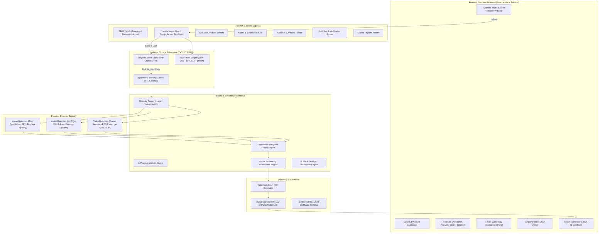

# SUTRAM: AI-Powered Multimedia Forensics Platform

[](https://www.python.org/downloads/)
[](https://fastapi.tiangolo.com)
[](https://opensource.org/licenses/MIT)
[](https://github.com/astral-sh/ruff)
[](https://www.iso.org/standard/44381.html)

> **SUTRAM** (सूत्रम्) is an enterprise-grade, air-gapped multimedia digital forensics platform built for digital forensic examiners, cyber-crime investigators, lab reviewers, and prosecutors. The platform authenticates digital evidence, localizes tampering, detects generative AI/deepfakes across image, video, and audio modalities, and assesses the legal and evidentiary value of digital media.

---

## 1. System Architecture



---

## 2. Five Core Deliverables

1. **Deepfake and Synthetic Media Detection Engine**:
   - Multi-modality detection of AI-generated content across image, audio, and video.
   - Explainable visual heatmaps (Grad-CAM, 2D Fourier power spectrum, Mel-spectrograms).
2. **Multimedia Authentication and Tampering Detection Framework**:
   - Pixel-level tampering localization via Error Level Analysis (ELA).
   - Keypoint-based copy-move cloning detection with spatial clustering.
   - Facial boundary blending discontinuity analysis.
   - Video GOP structure, re-encoding detection, and presentation timestamp (PTS) continuity analysis.
   - Audio splice and ambient noise-floor jump detection.
3. **Multimedia Provenance and Source Attribution Tool**:
   - Verification of Coalition for Content Provenance and Authenticity (C2PA) cryptographic manifests.
   - Deep EXIF/XMP parsing, software signature extraction, and camera hardware mismatch checks.
   - Multi-hash lineage tracking (SHA-256, SHA-512, perceptual hashes).
4. **Explainable AI-Based Forensic Analysis Dashboard**:
   - High-density dark-themed examiner workbench.
   - Dual-view and slider overlays (Original vs ELA / Noise / Match vectors).
   - Synchronized video timeline flagging suspicious frames and splice candidates.
   - Continuous audio waveform and spectrogram viewer.
   - **4-Axis Evidentiary Assessment Panel** (Integrity, Authenticity, Provenance, Suitability).
5. **Automated Forensic Reporting System**:
   - Court-ready PDF reports compiled via pure-Python ReportLab with embedded visual evidence artifacts.
   - Cryptographic digital signing (HMAC-SHA256 / Ed25519) over canonical report JSON.
   - Electronic Record Certificate template under **Section 63 of the Bharatiya Sakshya Adhiniyam, 2023**.

---

## 3. Team Task Specifications & AI Agent Directives

The project tasks are distributed across four dedicated team roles. Each role has a complete, self-contained specification file designed for developers and autonomous AI agents:

| Team Member | Domain & Ownership | AI Agent & Developer Specification |
|:---|:---|:---|
| **Kartikey** | Backend Core, Ingest Lifecycle, Storage Isolation, Hash-Chained Audit Engine, 4-Axis Evidentiary Assessment, Fusion Engine, C2PA Provenance, Signed Reporting & System Integration | 👉 **[`docs/team/KARTIKEY.md`](file:///docs/team/KARTIKEY.md)** |
| **Shivendra** | Lead Image Forensics, Error Level Analysis (ELA), Copy-Move Keypoint Forgery, Metadata & Software Traces, 2D FFT Frequency Anomalies, Face Blending & Deep Classifier Grad-CAM | 👉 **[`docs/team/SHIVENDRA.md`](file:///docs/team/SHIVENDRA.md)** |
| **Saksham** | Lead Audio Forensics, wav2vec 2.0 Voice Cloning Classifier, Splice & Ambient Noise Cuts, Pitch (F0) & Pause Dynamics, Spectral Vocoder Artifacts, Codec Quality Warnings | 👉 **[`docs/team/SAKSHAM.md`](file:///docs/team/SAKSHAM.md)** |
| **Saarika** | Lead Video Forensics, Multi-Tier Frame Sampling, Facial Blood Volume Pulse (rPPG), Audiovisual Lip-Sync Lag Correlation, Temporal Jitter, Container & GOP Forensics | 👉 **[`docs/team/SAARIKA.md`](file:///docs/team/SAARIKA.md)** |

---

## 4. Non-Negotiable Forensic Design Principles

- **Evidence Inviolability (ISO/IEC 27037)**: Original media files are written once to vault storage with read-only permissions (`0444`). All analysis executes exclusively on ephemeral working copies.
- **Tamper-Evident Audit Ledger**: System events are recorded in an append-only cryptographic ledger where each entry stores `prev_hash = SHA256(previous_entry)`. Any SQL tampering is flagged instantly.
- **No Fabricated Scores**: The system never produces random numbers. Unimplemented modules return `status="not_implemented"`, and mock fixtures are clearly marked `[MOCK]`.
- **Calibrated Verbal Scale**: Probabilities map to the 5-tier standard verbal scale: *Strongly supports authenticity*, *Supports authenticity*, *Inconclusive*, *Supports manipulation*, *Strongly supports manipulation*.
- **Air-Gapped Operation**: Designed to execute completely on-premise without external cloud APIs.

---

## 5. Quickstart & Developer Automation

### Prerequisites
- Python 3.12+ (or `uv` installed)
- Node.js 20+ and `npm`
- Git

### Installation & Execution
```bash
# 1. Clone repository
git clone https://github.com/mathurkartikey294-cmd/Sutram-.git
cd sutram

# 2. Automated setup (installs backend and frontend dependencies)
make setup

# 3. Start development servers
# Terminal 1: Backend API (http://localhost:8000)
make dev-backend

# Terminal 2: Frontend Examiner Workbench (http://localhost:5173)
make dev-frontend

# Or launch both via Docker:
make dev
```

### Verification & Testing
```bash
# Run backend test suite
make test

# Run code linters & type checkers
make lint

# Format codebase
make format

# Generate sample media fixtures
make samples

# Run detector evaluation benchmark
make eval
```

---

## 6. Project Documentation Index

- **Master AI Agents Guide**: [`AGENTS.md`](file:///AGENTS.md)
- **Claude & IDE Directives**: [`CLAUDE.md`](file:///CLAUDE.md)
- **System Architecture**: [`docs/ARCHITECTURE.md`](file:///docs/ARCHITECTURE.md)
- **REST API Specification**: [`docs/API.md`](file:///docs/API.md)
- **Detector Taxonomy**: [`docs/DETECTORS.md`](file:///docs/DETECTORS.md)
- **Tampering Mechanics**: [`docs/TAMPERING_METHODS.md`](file:///docs/TAMPERING_METHODS.md)
- **4-Axis Evidentiary Assessment**: [`docs/EVIDENTIARY_ASSESSMENT.md`](file:///docs/EVIDENTIARY_ASSESSMENT.md)
- **Forensic Standards & BSA 2023**: [`docs/FORENSIC_STANDARDS.md`](file:///docs/FORENSIC_STANDARDS.md)
- **Validated Datasets & Models**: [`docs/DATASETS_AND_MODELS.md`](file:///docs/DATASETS_AND_MODELS.md)
- **Forensic Boundaries & Limitations**: [`docs/LIMITATIONS.md`](file:///docs/LIMITATIONS.md)
- **5-Minute Examiner Demo Script**: [`docs/DEMO_SCRIPT.md`](file:///docs/DEMO_SCRIPT.md)
- **Team Plan & Milestone Matrix**: [`docs/TEAM_PLAN.md`](file:///docs/TEAM_PLAN.md)
- **Contributing & Git Workflow**: [`CONTRIBUTING.md`](file:///CONTRIBUTING.md)
- **Security Policy**: [`SECURITY.md`](file:///SECURITY.md)

---

## 7. License
Distributed under the **MIT License**. See [`LICENSE`](file:///LICENSE) for details.
