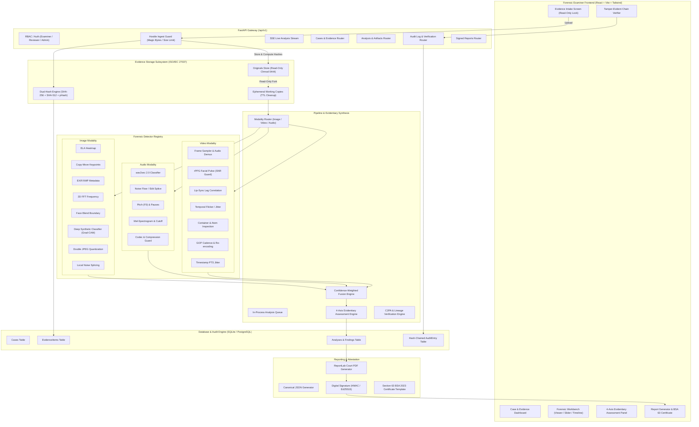

# SUTRAM Architecture Specification

## 1. High-Level System Architecture

SUTRAM is designed around a decoupled, modular, air-gapped digital forensics architecture that guarantees complete evidence preservation, strict auditability, and explainable evidentiary synthesis.



---

## 2. Storage & Evidence Isolation Model

Digital evidence admissibility requires unbroken proof that media was not altered post-acquisition.
1. **Ingest Phase**:
   - Incoming stream is verified via magic bytes (not file extensions).
   - Saved directly to `evidence_store/originals/<evidence_id>.<ext>`.
   - Simultaneous hash computation yields both `SHA-256` and `SHA-512`.
   - Original file permissions are locked to read-only (`chmod 0444` on Unix, Read-Only file attribute on Windows).
2. **Analysis Phase**:
   - The pipeline creates an ephemeral duplicate in `evidence_store/working/<analysis_id>.<ext>`.
   - All frame sampling, decoding, transcoding, and filtering occur solely on the working copy.
   - Working copies are automatically cleaned up after `WORKING_COPY_TTL_HOURS`.
3. **Re-Verification**:
   - The `/api/v1/evidence/{id}/verify` endpoint recomputes `SHA-256` and `SHA-512` directly from the original stored file and validates them against the ingest record in `EvidenceItem`.

---

## 3. Tamper-Evident Audit Hash Chain

To ensure the integrity of the investigative trail, every system action is recorded in an append-only cryptographic ledger:

$$\text{current\_hash}_i = \text{SHA-256}\Big(\text{id}_i \parallel \text{timestamp}_i \parallel \text{actor}_i \parallel \text{action}_i \parallel \text{target}_i \parallel \text{details\_json}_i \parallel \text{prev\_hash}_i\Big)$$

```
+-----------------------------------------------------------------------------+
| Audit Entry 1 (Genesis)                                                     |
| action: "evidence_ingest"                                                   |
| prev_hash: "0000000000000000000000000000000000000000000000000000000000000000"|
| current_hash: "a1b2c3d4..."                                                 |
+-----------------------------------------------------------------------------+
                                      |
                                      v
+-----------------------------------------------------------------------------+
| Audit Entry 2                                                               |
| action: "analysis_run"                                                      |
| prev_hash: "a1b2c3d4..."  <--- Binds strictly to previous record            |
| current_hash: "e5f6a7b8..."                                                 |
+-----------------------------------------------------------------------------+
                                      |
                                      v
+-----------------------------------------------------------------------------+
| Audit Entry 3                                                               |
| action: "report_generated"                                                  |
| prev_hash: "e5f6a7b8..."                                                    |
| current_hash: "9c0d1e2f..."                                                 |
+-----------------------------------------------------------------------------+
```

If an adversary alters an action description, deletes an entry, or forges a timestamp in the database, the hash chain breaks from that point forward. The `/api/v1/cases/{id}/audit/verify` endpoint recalculates the chain and immediately flags the altered record.

---

## 4. The 4-Axis Evidentiary Assessment Model

Instead of collapsing complex forensic evidence into an arbitrary single "deepfake probability" percentage, SUTRAM evaluates digital evidence across four orthogonal axes:

| Axis | Forensic Question | Key Signals & Methods | Verdict Options |
|:---|:---|:---|:---|
| **1. Integrity** | Was the file altered post-acquisition? | Hash verification, container atom integrity, re-encoding traces, double-compression markers, timestamp continuity. | Intact / Suspicious / Tampered / Inconclusive |
| **2. Authenticity** | Was the content synthetically generated or manipulated? | ELA, copy-move keypoint clusters, wav2vec anti-spoofing, deep synthetic classifiers, rPPG pulse consistency, lip-sync alignment. | Authentic / Supports Authenticity / Inconclusive / Supports Manipulation / Strongly Supports Manipulation |
| **3. Provenance** | Where did the file originate, and can origin be proven? | C2PA signed manifests, EXIF/XMP hardware/software signatures, perceptual hash lineage, reverse hash search. | Verified Origin / Claimed Origin / Stripped / Unknown |
| **4. Suitability** | Is the media quality sufficient for reliable forensic analysis? | Resolution, bitrate, duration, audio sample rate, codec compression factor. | Suitable / Marginal / Unsuitable (with warnings) |

---

## 5. Security Architecture for Hostile Inputs
- **Process Isolation**: All subprocesses (`ffmpeg`, `exiftool`, `c2patool`) run via `safe_subprocess()` with `shell=False`, array-based argument vectors, explicit execution timeouts, and sanitized environment variables.
- **Image Decompression Defense**: Pillow `MAX_IMAGE_PIXELS` is strictly clamped to avoid memory exhaustion from decompression bombs.
- **Privacy & Redaction**: The platform does not log raw evidence bytes or personal user data; logs store only opaque UUIDs and cryptographic hashes.
- **Air-Gapped Operation**: System configuration disables all default external network requests, ensuring evidentiary compliance for classified or sensitive forensic laboratories.
