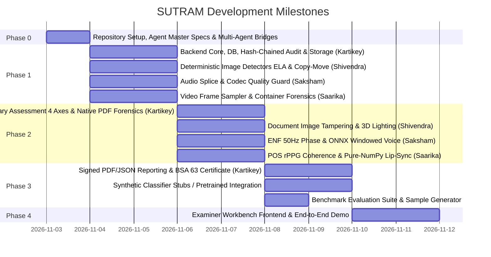

# SUTRAM Team Plan & Task Ownership Matrix

This document defines the task division, ownership boundaries, and milestone schedule for the SUTRAM project team: **Kartikey**, **Shivendra**, **Saksham**, and **Saarika**.

---

## 1. Team Ownership Matrix

| Member | Primary Role | Owned Components | Dedicated Specification |
|:---|:---|:---|:---|
| **Kartikey** | Backend Core, Provenance, Reporting & Integration Lead | `backend/app/core/`, `backend/app/db/`, `backend/app/pipeline/`, `backend/app/provenance/` (incl. Native PDF tampering), `backend/app/reporting/`, `backend/app/api/`, `frontend/` integration | [`docs/team/KARTIKEY.md`](file:///docs/team/KARTIKEY.md) |
| **Shivendra** | Lead Image Forensics Engineer | `backend/app/detectors/image/` (ELA, Copy-Move, Document Tampering, Metadata, Noise/Frequency, Face Blend, Deep Classifier, 3D Lighting) | [`docs/team/SHIVENDRA.md`](file:///docs/team/SHIVENDRA.md) |
| **Saksham** | Lead Audio Forensics Engineer | `backend/app/detectors/audio/` (wav2vec 2.0 / ONNX Probe, Splice Discontinuities, ENF 50Hz Tracking, Prosody/Pauses, Spectral Mel-Spectrogram, Codec Guard) | [`docs/team/SAKSHAM.md`](file:///docs/team/SAKSHAM.md) |
| **Saarika** | Lead Video Forensics Engineer | `backend/app/detectors/video/` (Frame Sampler, POS rPPG Pulse & Coherence, Lip-Sync Lag, Temporal Jitter, Container, GOP Cadence, PTS Jitter) | [`docs/team/SAARIKA.md`](file:///docs/team/SAARIKA.md) |

---

## 2. Milestone Roadmap

---

## 3. Detailed Milestone Checklist

### Milestone 1: Core Framework & Deterministic Baselines
- [ ] **Kartikey**:
  - [ ] Implement ISO/IEC 27037 read-only evidence store and ephemeral working copy generator.
  - [ ] Implement tamper-evident append-only audit log with RFC 8785 canonical JSON hashing (`prev_hash`).
  - [ ] Expose audit verification endpoint `/api/v1/cases/{id}/audit/verify`.
  - [ ] Define shared Pydantic schemas and database models.
- [ ] **Shivendra**:
  - [ ] Implement `ErrorLevelAnalysisDetector` (`ela.py`) with false-color PNG heatmap output.
  - [ ] Implement `CopyMoveDetector` (`copy_move.py`) using ORB/AKAZE keypoints and spatial clustering.
  - [ ] Implement `ImageMetadataDetector` (`metadata.py`) extracting EXIF/XMP software traces and thumbnail mismatches.
- [ ] **Saksham**:
  - [ ] Implement `AudioSpliceDetector` (`splice_discontinuity.py`) detecting ambient noise floor jumps (>12dB) and silence splices.
  - [ ] Implement `AudioCodecDetector` (`codec.py`) flagging telephony bandwidth (8kHz) and heavy compression.
- [ ] **Saarika**:
  - [ ] Implement `VideoFrameSampler` (`frame_sampler.py`) with multi-tier sampling (1-2 fps sparse vs dense windows) and audio demux.
  - [ ] Implement `VideoContainerDetector` (`container.py`) detecting FFmpeg/Lavf atom signatures and header conflicts.

### Milestone 2: Advanced Forensic Modules & Evidentiary Synthesis
- [ ] **Kartikey**:
  - [ ] Implement Native PDF structure tampering forensics (`provenance/pdf_document.py`): incremental update extraction, font mismatches & OCR layer diffs.
  - [ ] Build weighted-confidence Fusion Engine (`pipeline/fusion.py`) with conflict-to-`INCONCLUSIVE` resolution.
  - [ ] Build 4-Axis Evidentiary Assessment engine (`pipeline/evidentiary_assessment.py`): Integrity, Authenticity, Provenance, Suitability.
  - [ ] Implement Provenance tracker (`provenance/hashing.py`, `provenance/c2pa.py`).
- [ ] **Shivendra**:
  - [ ] Implement Document Image Tampering detector (`document_tampering.py`): altered digits halo, cloned rubber stamps & signatures.
  - [ ] Implement 3D Corneal lighting & reflection consistency (`lighting_experimental.py`): iris highlight position (Hu et al. 2021) & YCbCr chroma/shading gaps.
  - [ ] Implement 2D Fourier power spectrum analysis (`noise_frequency.py`) to detect diffusion/GAN grid artifacts.
  - [ ] Implement `FaceBlendDetector` (`face_blend.py`) analyzing landmark contour sharpness and noise variance.
  - [ ] Implement `DoubleJPEGDetector` (`double_jpeg.py`) analyzing DCT quantization histograms.
- [ ] **Saksham**:
  - [ ] Implement CPU-optimized windowed ONNX voice clone detector (`wav2vec_classifier.py` / ONNX probe).
  - [ ] Implement Electrical Network Frequency 50Hz phase tracking (`spectral.py`).
  - [ ] Implement `ProsodyPausesDetector` (`prosody_pauses.py`) calculating fundamental pitch ($F_0$) jitter and pause duration histograms.
  - [ ] Implement `AudioSpectralDetector` (`spectral.py`) generating Mel-spectrogram artifact PNGs and detecting high-frequency cutoffs.
- [ ] **Saarika**:
  - [ ] Implement POS (Plane-Orthogonal-to-Skin) rPPG pulse extraction & spatial cheek/forehead coherence (`rppg.py`).
  - [ ] Implement pure-NumPy lip-sync cross-correlation lag ($[-400\text{ms}, +400\text{ms}]$) (`lipsync.py`).
  - [ ] Implement `TemporalInconsistencyDetector` (`temporal.py`) detecting facial landmark jitter and boundary optical flow anomalies.

### Milestone 3: Reporting, Evaluation & ML Integration
- [ ] **Kartikey**:
  - [ ] Generate signed PDF reports (`reporting/pdf.py`) with embedded evidence heatmaps and HMAC-SHA256 digital signature.
  - [ ] Implement Section 63 Bharatiya Sakshya Adhiniyam, 2023 legal certificate template (`certificate_bsa63.py`).
  - [ ] Write benchmark evaluation suite (`backend/evaluation/eval.py`).
- [ ] **Shivendra**:
  - [ ] Wire deep synthetic image classifier (`cnn_classifier.py`) with Grad-CAM heatmap generation and deterministic MOCK fallback.
- [ ] **Saksham**:
  - [ ] Wire wav2vec 2.0 voice cloning classifier (`wav2vec_classifier.py`) with sliding-window suspiciousness timeline.
- [ ] **Saarika**:
  - [ ] Aggregate frame-level synthetic scores and build synchronized video timeline of suspicious segments.

### Milestone 4: Frontend Workbench & Final Demo Polish
- [ ] Evidence Intake screen with read-only lock confirmation.
- [ ] Side-by-side / overlay slider for Original vs Heatmaps (ELA, Copy-Move, Document Tampering, Grad-CAM).
- [ ] Synchronized video player with suspicious segment markers and rPPG/lip-sync plots.
- [ ] Interactive audio waveform and spectrogram viewer.
- [ ] 4-Axis Evidentiary Assessment cards with "What this means for the case" narrative.
- [ ] One-click audit chain verification badge.
- [ ] One-click export for cryptographically signed PDF and JSON reports.
